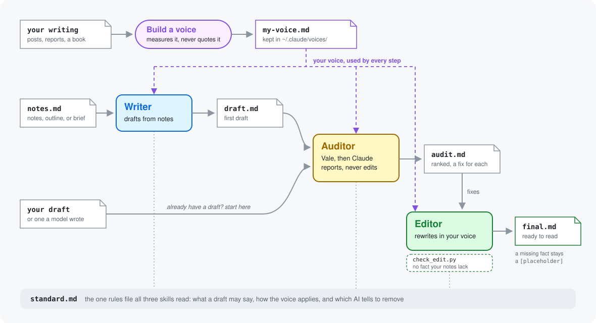

# ai-tells

ai-tells is a Claude Code plugin for writing from your notes. It drafts in your voice, then finds the phrasing that makes text read as AI and fixes it. It never adds a fact your notes don't have. Where a fact is missing, it leaves a bracketed placeholder for you to fill.

- **Write a draft from your notes.** `/ai-tells:ai-tells-writer` turns notes, an outline, or a brief into connected paragraphs and keeps every point in order. It then checks and edits its own draft, and leaves the first draft and the audit report next to the finished one. It also lists any sentence that isn't in your notes, and you decide whether it stays.
- **Write in your own voice.** Give Claude samples of your writing, such as posts, reports, or a book, and it builds a voice profile from them. Drafts then follow your sentence length, layout, and habits. The profile stays on your machine and never quotes your samples. Without one, the writer uses the `plain` voice. See [Voices](#voices).
- **Check a draft for AI tells.** `/ai-tells:ai-tells-auditor` works on any draft, whether you or a model wrote it. It ranks what it finds and gives a fix for each. It catches stock phrases, inflated words, filler, hedges, em dashes, and sentences that all run the same length. It also flags what a linter can't see, such as invented details and claims with no source. It reports and leaves the text alone.
- **Fix a draft.** `/ai-tells:ai-tells-editor` rewrites the flagged sentences in your voice and cuts repeats and summaries. A script then compares the edit with your notes, or with the original when you have no notes. Any number, name, or quote the edit added becomes a placeholder.

<picture>
  <source media="(prefers-color-scheme: dark)" srcset="assets/flow-dark.svg">
  
</picture>

## Install

You need Vale on your `PATH`:

```bash
brew install vale    # or see https://vale.sh/docs/install
```

**As a plugin** (Claude Code):

```
/plugin marketplace add vestjoe/ai-tells
/plugin install ai-tells@ai-tells
```

**By hand:** copy the skill folders into your skills directory.

```bash
git clone https://github.com/vestjoe/ai-tells.git
cp -R ai-tells/skills/ai-tells-* ~/.claude/skills/
```

On first use the skill runs `vale sync` to fetch the third-party packs, so it needs network access once.

## Use

Ask Claude in your own words:

- "Write a draft from `chapter5-notes.md` in my voice."
- "Build a voice called `my-voice` from the files in `~/writing/samples/`."
- "Check `docs/launch-post.md` for AI tells."
- "Does this email sound like ChatGPT wrote it?" followed by the pasted text.
- "Tighten this README and fix what you find." The auditor reports, and the editor makes the fixes.
- "Edit `chapter4.md` against my outline in `chapter4-outline.md`."

Or run a skill by name, with the files after it:

```
/ai-tells:ai-tells-writer notes/chapter4-outline.md
/ai-tells:ai-tells-writer notes/chapter4-outline.md my-voice
/ai-tells:ai-tells-auditor docs/launch-post.md
/ai-tells:ai-tells-editor drafts/chapter4.md notes/chapter4-outline.md
```

The writer saves its draft next to the notes as `<notes-name>.draft.md`. It audits that draft into `<notes-name>.audit.md`, then edits a copy into `<notes-name>.final.md`. The editor's own files, `<notes-name>.final.orig.md` and `<notes-name>.final.claims.md`, stay beside them. With no voice named, the writer uses `plain`.

The auditor reports and leaves the file alone. To apply fixes, ask for them or pick findings from its report, and it hands those to the editor. For a short text pasted into the chat, such as an email or a message, it runs the editor without being asked and shows the fixed text.

The editor saves the original as `<name>.orig.md` and edits the draft in place. It runs `scripts/check_edit.py` to confirm the edit didn't add a fact. With notes, the script checks facts against the notes alone. Without notes, it checks them against the original draft.

You can also run the linter pass yourself. From a clone of this repo:

```bash
skills/ai-tells-auditor/scripts/audit.sh draft.md              # one line per finding
skills/ai-tells-auditor/scripts/audit.sh --min=warning docs/   # warnings and errors only
skills/ai-tells-auditor/scripts/audit.sh --json draft.md       # Vale's JSON
pbpaste | skills/ai-tells-auditor/scripts/audit.sh             # the clipboard (macOS)
```

`audit.sh` exits 1 when Vale reports any `error`, so it works as a CI gate.

## Voices

A voice profile tells the writer how someone writes. It's one Markdown file with:

- **Numbers** measured from writing samples, such as sentence and paragraph length. Headings, tables, and list items don't count, because they show how a document was laid out, not how its writer writes.
- **Layout**: when to use lists and headings, and how long a paragraph runs. The writer asks you for these instead of copying the samples' layout. With no answer, drafts use connected paragraphs, with lists only for ordered steps or values the reader looks up.
- **Habits to keep**, each with a short example of connected sentences written for the profile.
- **Habits to avoid**, taken from the auditor's warnings and errors on the samples, so the writer doesn't learn them.

Person (`I`, `we`, or `you`) isn't part of a voice. The writer picks it for each piece from the notes, and asks when the notes don't make it clear.

The plugin comes with one voice, `plain`, in `skills/ai-tells-writer/voices/plain.md`. It's the default, and the example of the format.

To build your own, ask Claude to build a voice from your writing samples and give it a name. The writer follows `references/build-voice.md`. It measures the samples, then asks you about the layout for new writing. It runs the auditor on the samples, then writes the habits in new words and runs the auditor on the profile's own examples. Last, `scripts/check_voice.py` confirms the profile doesn't copy any run of 8 or more words from the samples.

Your profiles live in `~/.claude/voices/<name>.md`, outside the plugin, so they survive updates and reinstalls. The writer looks there first, then at the voices that come with the plugin.

**Keep profiles and samples out of repositories.** Samples are often private, such as a book or client reports. Work on them in a scratch folder, and save the profile only to `~/.claude/voices/`.

## How it works

The skills share one rules file, `skills/ai-tells-auditor/references/standard.md`. It sets what a draft may say and how a voice applies. It also lists the AI tells to remove and says how to keep sentences linked. The writer and the editor both work to it, and the auditor reports where a draft misses it.

The auditor works in two passes. [Vale](https://vale.sh) checks the wording with a pinned config. Then Claude reads the content for problems Vale doesn't catch, from invented specifics and unsourced claims about people to false balance and section formulas that repeat. You get one ranked list of findings with a fix for each.

## What's in the skills

In `skills/ai-tells-auditor/`:

- `SKILL.md`: the audit steps Claude follows. It reports and doesn't edit.
- `references/standard.md`: the shared standard that all three skills read.
- `.vale.ini`: turns on `Custom` and five packs, each pinned to a release:
  - [vale-ai-tells](https://github.com/tbhb/vale-ai-tells): AI-writing patterns.
  - [proselint](https://github.com/vale-cli/proselint): clichés and redundancy.
  - [write-good](https://github.com/vale-cli/write-good): weasel words.
  - [Microsoft](https://github.com/vale-cli/Microsoft) and [Google](https://github.com/vale-cli/Google): sentence length, adverbs, jargon, tense, and contractions.

  It also turns off pack rules that repeat another rule or whose hits don't need fixing, and says why for each.
- `styles/Custom/`: our rules, one YAML file each. Alerts from them start with `Custom.`. `vale sync` downloads the other folders in `styles/`, and git ignores them.
- `references/review-prompt.md`: the checklist for the judgment pass. It also works as a prompt for a person or another model.
- `scripts/audit.sh`: runs Vale with this config and prints one line per finding. It fetches the packs first if they're missing.

In `skills/ai-tells-writer/`:

- `SKILL.md`: the drafting steps.
- `references/build-voice.md`: the steps for building a voice from samples.
- `voices/plain.md`: the default voice.
- `scripts/voice_stats.py`: measures samples for a profile's numbers.
- `scripts/check_voice.py`: finds runs of 8 or more words a profile copied from its samples.

In `skills/ai-tells-editor/`:

- `SKILL.md`: the editing steps, with or without notes.
- `scripts/check_edit.py`: compares the original and the edit and prints cut, reworded, and new sentences, plus any section that grew. It flags as `FACT` any number, name, quoted string, or code span the source lacks, and any fenced code block that differs from the source. It exits 1 when it finds one.

## How to read the results

<!-- vale off -->
- **Level** ranks how much a fix is likely to help. `error` items (service filler, "not just X, but Y", "In summary") are rarely worth keeping. `suggestion` items (passives, hedges, single em dashes) are often fine; check them when the text reads flat.
- **A hit is a prompt, not a verdict.** "Robust" is a real property of a statistic, and "studies show" is fine with a citation after it. Reread the sentence and keep it if it says something specific.
<!-- vale on -->
- **Vale can't judge content.** Invented facts, unsourced claims about people, and false balance need a careful read. The skill's second pass covers them.

## Turning rules off

For a range of lines:

```markdown
<!-- vale Custom.StockAdjective = NO -->
A robust estimator.
<!-- vale Custom.StockAdjective = YES -->
```

`<!-- vale off -->` … `<!-- vale on -->` turns every rule off. To turn a rule off everywhere, add a line such as `Custom.Passive = NO` under `[*.{md,txt}]` in `skills/ai-tells-auditor/.vale.ini`.

## Tests

```bash
python3 tests/test_tells.py    # or: pytest. Needs vale on PATH, or VALE=/path/to/vale
```

Most tests use `tests/vale.ini`, which turns on `Custom` only, so a pack update doesn't change them. Tests that call `audit.sh` use the full config.

## Extending

Each rule is one file in `skills/ai-tells-auditor/styles/Custom/`. Add the pattern, then add a case to `test_catches_each_category` in `tests/test_tells.py`.

## License

MIT. The Vale packs fetched by `vale sync` keep their own licenses.
